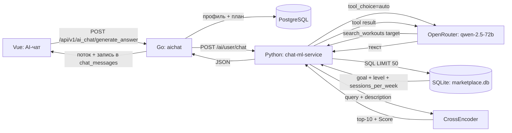

# 08. Как работают рекомендации

[Проект](01_PROJECT.md) · [API](02_API.md) · [ML](05_ML.md)

Документ описывает **фактическую** рекомендацию программ маркетплейса в AI-чате. Генерация персонального плана (CatBoost) — отдельный контур, см. [05_ML.md](05_ML.md#plan-generator).

## 1. Схема



## 2. Запрос Go → Python

Go берёт профиль и план из PostgreSQL и отправляет:

```json
{
  "plan": { "тип_сплита": "Фулбади", "еженедельный_план": [] },
  "user": {
    "возраст": 26,
    "рост": 175,
    "вес": 75,
    "пол": "м",
    "тип_активности": "Средняя активность",
    "травмы_или_болезни": "нет",
    "цель": "Набрать мышцы",
    "уровень_подготовки": "новичок",
    "дни_тренировок": ["Пн", "Ср", "Пт"]
  },
  "model": "llama3.1-8b",
  "messages": [
    { "role": "user", "content": "Подбери программу на массу на 3 дня" }
  ]
}
```

Источник: `backend/internal/features/mlclient/aichat/payload.go`.

Python поле `model` не использует — модель задана в коде: `qwen/qwen-2.5-72b-instruct`.

## 3. Что происходит внутри

1. LLM получает системный промпт (профиль + план) и последние 10 сообщений.
2. Если запрос про подбор тренировки — вызывает tool `search_workouts` с `target`.
3. `SqlFillterPlans` выгружает до 50 опубликованных версий и фильтрует по:
   - `goal` = цель пользователя;
   - `level` = уровень подготовки;
   - `sessions_per_week` = число дней в `training_days_map`.
4. `CrossEncoderRanker` (`cross-encoder/mmarco-mMiniLMv2-L12-H384-v1`) считает пары «запрос + описание», сортирует по `Score` и оставляет top-10.
5. LLM получает список `program_id` + `description` и формирует текст ответа.
6. Python возвращает `program_ids` — первые 3 элемента top-10.

Оборудование, травмы, покупки, просмотры и рейтинг в отборе **не участвуют**.

## 4. Ответ Python → Go

```json
{
  "role": "assistant",
  "content": "Вот три программы...",
  "program_ids": ["uuid-1", "uuid-2", "uuid-3"]
}
```

Если tool не вызывался:

```json
{ "role": "assistant", "content": "...", "program_ids": [] }
```

## 5. Что Go отдаёт дальше

- POST `/api/v1/ai_chat/generate_answer` — потоково пересылает тело Python без разбора.
- В `sportapp.chat_messages` сохраняется **сырое тело** как `assistant.content`.
- GET `/api/v1/ai_chat/history` возвращает только `role` и `content`:

```json
[
  { "role": "user", "content": "Подбери программу..." },
  { "role": "assistant", "content": "{\"role\":\"assistant\",\"content\":\"...\",\"program_ids\":[...]}" }
]
```

- Frontend ответ POST не читает: после отправки он перезапрашивает историю и рендерит `content` как Markdown.
- **`program_ids` до UI не доходят**, карточек программ нет.

## 6. Ограничения текущей версии

- `marketplace.db` в репозитории отсутствует; используется SQLite, не PostgreSQL-каталог.
- Docker-образ не содержит `sqlalchemy`, `sentence-transformers`, `torch`, `openai`.
- Compose запускает `chat.chat_ml_service:app`, но файл называется `chat-ml-service.py` — модуль не импортируется.
- Нет фильтра по оборудованию, дедупликации версий, `reason_codes` и `evidence`.
- Тестов на retriever/ranker/чат нет.

## 7. Файлы

| Что | Где |
|---|---|
| Go-прокси и история | `backend/internal/features/mlclient/aichat/` |
| Python-чат и tool calling | `ai/chat/chat-ml-service.py` |
| SQL-этап | `ai/chat/recommended_system/sql_worker.py` |
| CrossEncoder-этап | `ai/chat/recommended_system/model_worker.py` |
| Оркестратор | `ai/chat/recommended_system/pipline.py` |
| UI | `frontend/src/views/workout/AiChatScreen.vue` |
