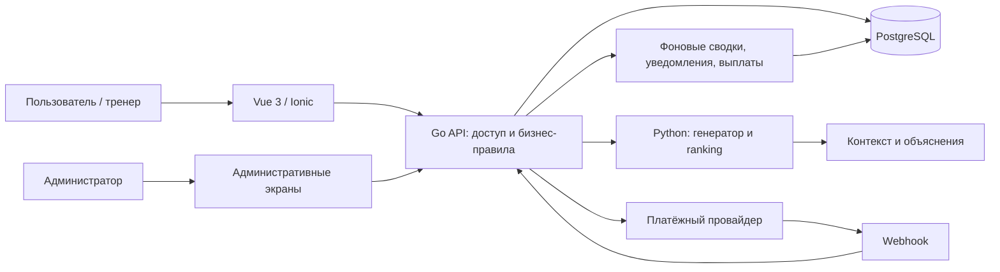

# 01. AI Fitness Coach Ecosystem — описание проекта

Дата: 05.10.2026. Название текущего приложения: «Спортик».

[API](02_API.md) · [Экраны](03_FRONTEND.md) · [БД](04_DATABASE.md) · [ML](05_ML.md)

## 1. Назначение и цель

AI Fitness Coach Ecosystem — спортивная платформа, объединяющая персональные тренировочные планы, выполнение тренировок, анализ прогресса, AI-ассистента и маркетплейс программ профессиональных тренеров. 

## 2. Что уже сделано

- Гостевой аккаунт, регистрация, вход, JWT
- Анкета и профиль
- Персональный план тренировок
- Замена упражнения, рабочие веса
- Результаты, достижения, highlights
- AI-чат и история
- Питание, блюда, вода, вес и цели
- Личные заметки
- Интерфейс и контейнеризация 

## 3. Роли пользователей

| Роль | Возможности |
|---|---|
| Гость приложения | Пройти анкету и использовать текущие базовые функции с гостевым JWT |
| Загеристрированный Пользователь | Личные планы, результаты, избранное, покупки, отзывы после использования, подписки, Fork и ссылки |
| Тренер | Все права пользователя плюс авторские программы, кабинет, статистика и заявка на проверку |
| Администратор | Модерация, блокировки, проверка тренеров, справочники, жалобы, покупки, выплаты, комиссия и аналитика |

Покупки и публикации требуют регистрации. «Проверенный тренер» — отдельный признак после решения администрации, а не автоматическое следствие роли. 

## 4. Функции и сценарии семестра

F01–F12 — сквозные идентификаторы во всех документах. Новые API относительно `/api/v2`.

| ID | Функция и сценарий | API | Экраны | ML / сущности |
|---|---|---|---|---|
| F01 | **Маркетплейс тренировочных программ.** Это раздел приложения, в котором профессиональные тренеры публикуют собственные программы, а пользователи находят подходящий вариант для своих занятий. При создании программы тренер описывает её содержание, указывает тренировочную цель, необходимый уровень подготовки, длительность, количество тренировок в неделю и оборудование. Программу можно сделать бесплатной или установить стоимость; после публикации автор сможет обновлять её содержание. Пользователь просматривает каталог и с помощью фильтров отбирает программы по цели, сложности, длительности и доступному оборудованию. В карточке программы он знакомится с описанием, автором и условиями доступа, после чего может сохранить её в избранное, получить бесплатно или перейти к покупке. | [Каталог и программы](02_API.md#f01) | [Каталог и карточка](03_FRONTEND.md#marketplace) | [Ranking](05_ML.md#recommendations), Program/ProgramVersion |
| F02 | **Продажи программ и выплаты тренерам.** Эта функция обеспечивает покупку платных программ и распределение дохода между автором и платформой. Пользователь выбирает программу, проверяет её стоимость и оплачивает заказ. Доступ к программе открывается после того, как сервер получает подтверждение успешной оплаты. Платформа удерживает комиссию 20% от стоимости продажи, а оставшаяся часть начисляется автору. В личном кабинете тренер может просматривать сведения о продажах, начисленных суммах и выплатах, чтобы понимать, какой доход приносят его программы. Пользователь, в свою очередь, видит свои покупки и может вернуться к приобретённой программе из приложения. | [Заказы и расчёты](02_API.md#f02) | [Покупка](03_FRONTEND.md#purchase), кабинет |
| F03 | **Персональные рекомендации программ.** Рекомендательная система помогает пользователю выбирать программы, которые соответствуют его целям, подготовке и реальным условиям тренировок. Для этого она анализирует данные профиля, доступное оборудование и количество занятий в неделю, а также историю тренировок, рабочие веса и динамику прогресса. Дополнительными сигналами становятся просмотренные и сохранённые программы, покупки, оценки, отзывы и поведение внутри приложения. На основе этих данных система формирует персональную подборку и объясняет причину каждого предложения. Например, пользователь увидит, что программа рекомендована потому, что рассчитана на три занятия в неделю, соответствует его уровню и не требует недоступного оборудования. По мере накопления новых результатов и действий подборка будет уточняться. | [Подборка и события](02_API.md#f03) | [Рекомендации](03_FRONTEND.md#recommendations) | [Гибридный ranking и RAG](05_ML.md#recommendations) |
| F04 | **Улучшение качества генерации AI-плана.** Это направление посвящено развитию уже существующего механизма, который по данным анкеты определяет тип тренировочного сплита и помогает подобрать персональную программу. В этом семестре необходимо пересмотреть архитектуру модели, переработать признаки пользователя и улучшить обучающий датасет, увеличив количество и качество примеров. Одновременно будут улучшены правила выбора упражнений и формирования итогового плана с учётом доступных дней и ограничений пользователя. Для пользователя сценарий остаётся привычным: он заполняет анкету и получает программу. Результатом работы должно стать более точное и обоснованное составление плана, подтверждённое тестированием и сравнением с текущей версией. | [Генерация](02_API.md#f04) | [Анкета](03_FRONTEND.md#onboarding) | [Улучшение генератора](05_ML.md#plan-generator) |
| F05 | **Анализ тренировочного прогресса.** Эта функция расширяет историю занятий до системы, которая помогает пользователю понимать, как меняются его результаты. После каждой тренировки сервер сохраняет выполненные упражнения, подходы, повторения и рабочие веса, а затем рассчитывает объём нагрузки и сравнивает показатели с предыдущими занятиями. Пользователь автоматически получает сообщения о заметных изменениях: увеличении рабочего веса, новом личном рекорде или количестве завершённых тренировок. В разделе прогресса он может оценить регулярность занятий, выполнение тренировочного плана, результаты отдельных упражнений и изменение веса тела. Недельные и месячные сводки позволяют увидеть общую динамику, а просмотр за всё время — сравнить текущие показатели с началом тренировок. | [Тренировки и прогресс](02_API.md#f05) | [Прогресс](03_FRONTEND.md#progress) |
| F06 | **Универсальный конструктор тренировочных программ.** Конструктор позволяет пользователю самостоятельно составлять и редактировать программу в одном интерфейсе. Он создаёт тренировочные дни, добавляет упражнения, меняет их порядок и задаёт для каждого количество подходов, повторений, рабочий вес и время отдыха. Если упражнение не подходит, его можно заменить или удалить; для похожих занятий предусмотрено копирование целого дня. Пользователь также может добавлять и удалять дни и изменять расписание тренировок. Через этот же интерфейс редактируется программа, первоначально созданная AI: пользователь открывает готовый вариант и вносит нужные изменения. Таким образом, AI помогает сформировать основу плана, а окончательный выбор состава и расписания остаётся за пользователем. | [Личные планы](02_API.md#f06) | [Конструктор](03_FRONTEND.md#builder) |
| F07 | **Создание собственной версии программы — Fork / Remix.** Эта функция позволяет адаптировать доступную пользователю программу под свои предпочтения, сохранив исходный авторский вариант. Например, после покупки программы тренера пользователь нажимает «Создать свою версию», и приложение создаёт отдельную копию в его личных тренировочных планах. В ней можно менять упражнения, подходы, повторения, рабочие веса и расписание, а также добавлять или удалять тренировочные дни. Все изменения относятся только к личной копии и не затрагивают программу тренера. При этом сохраняется информация об авторе и исходной программе, чтобы пользователь понимал происхождение своего плана. Последующие изменения оригинала не синхронизируются с копией. | [Fork](02_API.md#f07) | [Конструктор](03_FRONTEND.md#builder) |
| F08 | **Публикация программы или тренировки по ссылке.** Пользователь может поделиться целой программой или отдельной тренировкой с помощью уникальной публичной ссылки, которую создаёт сервер. Получатель открывает её и знакомится с доступным содержимым: тренировочными днями, упражнениями, подходами и повторениями. После входа в приложение он может сохранить программу или создать собственную версию через Fork / Remix, если это разрешено условиями доступа. Для платной программы человек без доступа видит только превью и возможность получить доступ, а не полный состав тренировок. Публичное распространение содержимого производной копии платной программы требует разрешения автора. Такой механизм позволяет обмениваться программами, сохраняя контроль над авторским содержимым. | [Shares](02_API.md#f08) | [Публичный просмотр](03_FRONTEND.md#sharing) |
| F09 | **Рейтинги и отзывы после использования программы.** Эта функция помогает пользователям оценивать качество программ на основании опыта тех, кто действительно по ним тренировался. Возможность оставить отзыв появляется после трёх завершённых тренировок внутри программы, а не сразу после покупки; необходимое число занятий остаётся настраиваемым. Пользователь выставляет общую оценку и может дополнительно оценить соответствие заявленной сложности, качество структуры, соответствие описанию, удобство выполнения и достигнутый результат. В текстовом отзыве он описывает свой опыт и особенности программы. Оценки и отзывы отображаются в карточке и помогают другим пользователям принять решение. Право оставить отзыв проверяет сервер по фактически завершённым занятиям. | [Отзывы](02_API.md#f09) | [Отзывы](03_FRONTEND.md#reviews) |
| F10 | **Профессиональные профили тренеров и подписки.** Для тренеров создаётся отдельный тип профиля с именем, фотографией, описанием, специализацией, опытом работы и квалификацией. В нём также отображаются опубликованные программы, рейтинг и отзывы; сведения об использовании программ и продажах доступны тренеру в его кабинете. Чтобы подтвердить профессиональный статус, тренер подаёт заявку на проверку, и после одобрения администрацией получает отметку «Проверенный тренер». Пользователь может подписаться на интересующего автора и находить его в разделе «Мои тренеры». После подписки он получает уведомления о новых публикациях и обновлениях уже используемых программ, что позволяет следить за работой выбранных тренеров и быстрее находить их материалы. | [Тренеры](02_API.md#f10) | [Профиль и кабинет](03_FRONTEND.md#trainers) | TrainerProfile/Verification/Follow |
| F11 | **Персонализированная главная страница.** Главная страница становится дашбордом, который показывает пользователю наиболее полезную информацию в текущий момент. На ней размещаются сегодняшняя тренировка, текущий прогресс, сообщение AI-тренера, персональные рекомендации, подходящая программа из маркетплейса, последнее достижение и новые публикации авторов, на которых подписан пользователь. Порядок и содержание этих блоков зависят от его состояния. Если на сегодня запланировано занятие, на первый план выходит возможность начать тренировку; после её завершения — результаты и прогресс. Если пользователь давно не занимался, приложение предлагает вернуться к своему плану. Из каждого блока можно перейти к соответствующей функции, поэтому главная страница становится отправной точкой повседневной работы с приложением. | [Dashboard](02_API.md#f11) | [Главная](03_FRONTEND.md#dashboard) | Агрегаты backend и [ML](05_ML.md#recommendations) |
| F12 | **Административная панель управления платформой.** Это отдельный интерфейс, через который администратор контролирует работу приложения и маркетплейса. Он управляет пользователями и тренерами, подтверждает профессиональный статус, блокирует нарушителей, модерирует программы и отзывы и обрабатывает жалобы. В панели также доступны управление упражнениями и категориями, просмотр покупок, контроль выплат авторам и комиссии платформы. Аналитический раздел показывает количество пользователей и активных пользователей, завершённых тренировок, опубликованных программ и продаж, а также оборот маркетплейса и комиссию. Рейтинги популярности программ и тренеров помогают оценивать использование платформы. Администратор открывает нужный раздел, изучает данные и выполняет действие в пределах своих полномочий. | [Admin](02_API.md#f12) | [Админ-панель](03_FRONTEND.md#admin) |

## 5. Уточнения

1. Fork — самостоятельная личная копия плана тренировки с сохранённым авторством источника. Изменения не синхронизируются с оригиналом.
2. Ссылка на платную программу показывает превью программы человеку без доступа. Публичное распространение содержимого производной копии требует разрешения автора. 
3. Отзывы на план тренировок разрешается после 3  завершённых тренировок внутри программы; число конфигурируемое.

## 6. Архитектура

По Compose: 
- frontend 3000
- backend 5050
- ML-план 8000
- ML-чат 8001
- PostgreSQL локально 5433. 

