# 03. Экраны и поведение приложения

[Проект](01_PROJECT.md) · [API](02_API.md) · [Данные](04_DATABASE.md) · [ML](05_ML.md)

Дата: 05.10.2026.

## 1. Статус и визуальная концепция

### Пользователь: главная, каталог, программа, прогресс

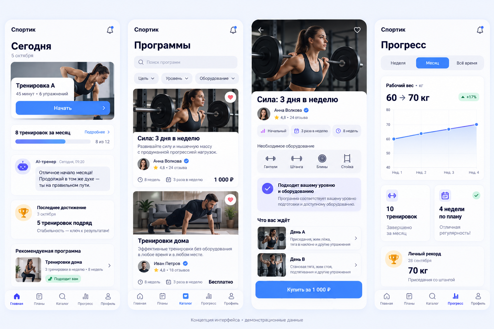

Слева направо: персональная главная, каталог, карточка платной программы, прогресс.

### Конструктор, тренер, кабинет, публичная ссылка

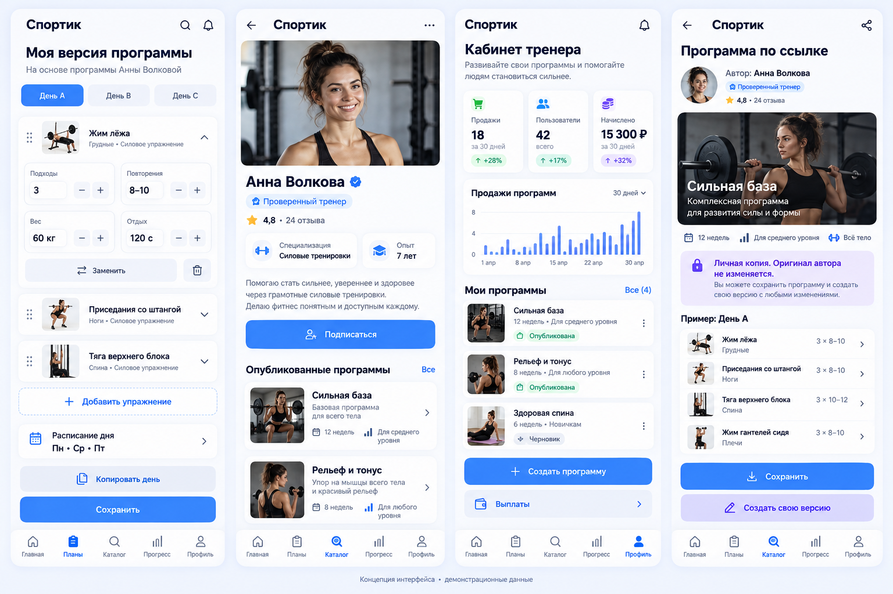

Слева направо: личная версия программы, профиль тренера, кабинет автора, разрешённая публичная программа.

### Административная панель

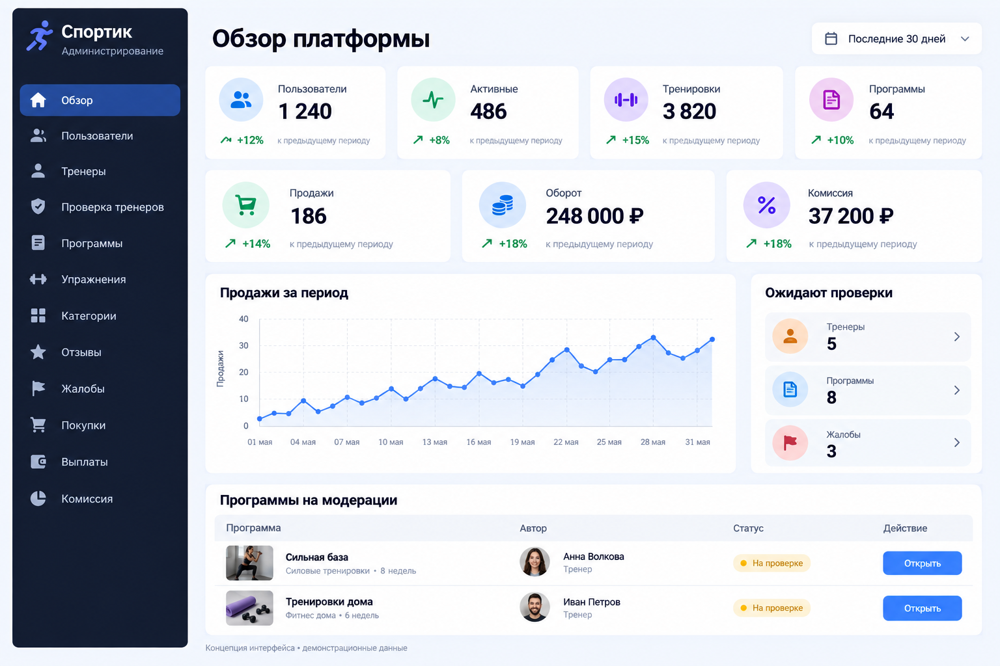

Продажи и суммы на изображении — пример компоновки. [API](02_API.md#f12).

## 2. Общие состояния и навигация

Целевая нижняя навигация: **Главная** `/home`, **Планы** `/plans`, **Каталог** `/marketplace`, **Прогресс** `/progress`, **Профиль** `/settings`. Питание, заметки, чат и «Мои тренеры» доступны из соответствующих разделов профиля/дашборда. Текущая нижняя навигация отличается; её изменение — часть нового этапа.

Публичные routes доступны без входа. При сохранении, Fork или покупке посетитель переходит на `/auth/login?return_to=...`; return_to проверяется как внутренний путь. Возвращение после входа не повторяет оплату автоматически.

## 3. Существующие маршруты: анкета и генерация

API в этой таблице имеют префикс `/api/v1`. Поля анкеты сохраняются через auth store и `POST /profile` с version.

| Экран / route | Назначение и отображение | Действия / переход | API | loading / empty / error / success |
|---|---|---|---|---|
| Приветствие `/` | Цель приложения, кнопка начала | Далее → текущий незаполненный шаг или `/home` | Создание гостя/профиль через auth store при необходимости | Инициализация / новая сессия / ошибка входа с повтором / переход |
| Параметры `/body-metrics` | Рост и вес | Ввести → `/gender`; назад | GET/POST `/profile` | Получение / пустые поля / неверные значения или конфликт / сохранены |
| Пол `/gender` | Выбор значения | Выбрать → `/age` | POST `/profile` | Сохранение / нет выбора / ошибка / выбор сохранён |
| Возраст `/age` | Возраст | Ввести → `/activity-type` | POST `/profile` | Сохранение / нет значения / диапазон/сеть / сохранён |
| Активность `/activity-type` | Уровень повседневной активности | Выбрать → `/health-restrictions` | POST `/profile` | Сохранение / нет выбора / ошибка / сохранено |
| Ограничения `/health-restrictions` | Текущее injuries_notes boolean | Указать → `/goal-selection` | POST `/profile` | Сохранение / нет ответа / ошибка / сохранено |
| Цель `/goal-selection` | Тренировочная цель | Выбрать → `/fitness-level` | POST `/profile` | Сохранение / нет выбора / ошибка / сохранено |
| Подготовка `/fitness-level` | Уровень | Выбрать → `/training-days` | POST `/profile` | Сохранение / нет выбора / ошибка / сохранено |
| Дни `/training-days` | Дни недели, число занятий | Выбрать → `/plan-generating`; в v2 сначала `/equipment` | POST `/profile` | Сохранение / нет дней / несовместимая частота / сохранено |
| Генерация `/plan-generating` | Индикатор и этап процесса | Повтор; изменить анкету; success → `/home` | POST `/plans/generate` | Генерация / профиль неполный / сервер/сеть/ML / план получен |
| Оборудование `/equipment` **новый** | Доступные снаряды, длительность занятия | Выбрать → генерация | Целевой профиль и справочник equipment, см. дополнение ниже | Загрузка / ничего не выбрано: вариант без оборудования / ошибка / профиль готов |

Дополнение профиля v2: GET/PATCH `/me/profile`, GET `/equipment`; тело PATCH `{version,goal,level,training_days,equipment_ids,session_duration_min,...}`.

## 4. Существующие основные экраны

API здесь `/api/v1`, кроме явно обозначенного будущего поведения.

| Экран / route | Что отображается | Действия и переходы | API | loading / empty / error / success |
|---|---|---|---|---|
| Главная `/home` | Сейчас список упражнений, сплит, оценка времени; новый dashboard — раздел 6 | Начать → `/workout/session` | План из store после генерации; отдельного GET dashboard v1 нет | Подготовка / нет плана / нет данных / список доступен |
| Инструменты `/workout-tools` | Смена плана, чат, параметры тела | Анкета, `/ai-chat` | Через целевые экраны | Подготовка / нет профиля / ошибка перехода / выбран инструмент |
| Сеанс `/workout/session` | Текущее упражнение, подходы, вес, повторы, отдых | Отметить подход; заменить; завершить | POST `/workouts/complete` в конце | Восстановление / нет активного плана / отправка не удалась, черновик сохранён / занятие подтверждено |
| Замена `/workout/alternatives/:slotIndex` | Альтернативы слота | Выбор → обратно в сеанс | Варианты уже в плане/store, отдельного v1 endpoint замены нет | Получение слота / нет альтернатив / неверный slotIndex / замена выбрана |
| Завершение `/workout/success` | Сохранение, highlights, достижения | Главная; в v2 прогресс/отзыв | Результат complete/store | Подтверждение / нет результата / несохранённое занятие / серверный результат |
| AI-чат `/ai-chat` | История, ввод, поток ответа | Отправить; повтор; вернуться | GET `/ai_chat/history`, POST `/ai_chat/generate_answer` | История/ответ / первое сообщение / сеть/лимит/провайдер / полный ответ |
| Заметки `/notes` | Личные заметки | Создать/открыть/удалить → `/notes/:id` | GET/POST `/notes`, DELETE `/notes/{id}` | Список / создать первую / ошибка / список обновлён |
| Редактор `/notes/:id` | Название и текст | Сохранить; назад | POST `/notes` либо PATCH `/notes/{id}` по режиму | Получение / новая заметка / ошибка с сохранением текста / сохранено |
| Профиль и настройки `/settings` | Учётная запись, достижения, настройки | `/settings/profile`; вход/регистрация в текущем auth panel | GET `/achievements/get_achievements`, auth APIs | Данные / нет достижений / ошибка / профиль доступен |
| Данные профиля `/settings/profile` | Анкета | Изменить/сохранить | GET/POST `/profile` | Данные / неполная анкета / валидация/409 / новая версия |

## 5. Существующее питание

API `/api/v1`; данные переиспользуются без дублирования истории веса.

| Экран / route | Отображение и действия | API | Переходы | loading / empty / error / success |
|---|---|---|---|---|
| Питание `/nutrition` | Дневная сводка калорий/БЖУ, вода, вес, приёмы пищи; выбрать день | entries, favorites, dashboard, stats, analytics | Приём пищи, цели, вода | Сводка / нет записей / частичная ошибка блока / актуальные данные |
| Дневник `/nutrition/add-meal` | Записи и порции; изменить/удалить | GET/POST entries, PATCH/DELETE entries/{id} | Поиск/выбор → питание | Записи / первый приём / ошибка / запись сохранена |
| Поиск `/nutrition/add-meal/search` | Поисковый ввод и блюда | GET dishes/search | Выбор блюда → picker | Поиск / нет совпадений / ошибка / результаты |
| Выбор `/nutrition/add-meal/picker` | Блюдо, граммы, тип приёма | POST entries; источник dishes/search | Назад в дневник | Данные / не выбрано блюдо / порция/сеть / добавлено |
| Цели `/nutrition/goals` | Цели и отчёты, изменение веса | GET goals, analytics; POST goals/recalculate, weight | Назад в питание | Расчёт / нет профиля/измерений / ошибка / цели обновлены |
| Вода `/nutrition/water` | Дневное количество | POST water, GET dashboard | Назад | Отправка / 0 мл / ошибка / подтверждено |
| Избранное `/nutrition/favorites` | Любимые блюда/продукты | GET/POST favorites, DELETE favorites/{id} | В picker | Список / нет избранного / ошибка / обновлено |
| Мои блюда `/nutrition/my-dishes` | Созданные блюда, БЖУ, базовые граммы | GET dishes/mine, POST dishes, PATCH/DELETE dishes/{id} | В picker/питание | Список / создать первое / ошибка / сохранено |

## 6. F11 — персональная главная `/home`

**Статус:** переработка существующего экрана. **Назначение:** следующий полезный шаг пользователя. **API:** GET `/api/v2/dashboard`; ссылки блоков ведут на план, прогресс, чат, каталог, тренера, уведомления. **Макет:** первый экран user-experience.

Блоки: сегодняшняя тренировка, текущий прогресс, AI-сообщение, персональная рекомендация, программа маркетплейса, последнее достижение, публикации подписок. Приоритет определяется state из backend.

| Состояние пользователя | Первый блок | Основное действие |
|---|---|---|
| new_user | Заполнить профиль/получить план | Анкета, каталог или конструктор |
| workout_today | Сегодняшний день и длительность | Начать тренировку |
| just_completed | Результат и изменения | Открыть прогресс |
| rest_day | Прогресс/следующая тренировка | Посмотреть план |
| inactive | Мягкое предложение вернуться | Открыть активный план, без давления |

loading — skeleton блоков; empty — понятный следующий шаг; error — повтор основного запроса, отдельный unavailable блок не скрывает всю страницу; success — блоки с актуальной датой. Отсутствующая рекомендация не подменяется вымышленной персональной карточкой.

## 7. F01 — каталог и карточка

| Экран / route | Отображение | Действия | API v2 | Переходы |
|---|---|---|---|---|
| Каталог `/marketplace` | Поиск, цель, уровень, недели, оборудование, бесплатные/платные; карточки автора, цены, частоты, рейтинга | Фильтровать, сортировать, сохранить; сбросить фильтры | GET catalog/programs, catalog/categories; GET/PUT/DELETE me/favorites | Карточка, тренер, рекомендации |
| Карточка `/marketplace/programs/:programId` | Описание, цель, уровень, длительность, оборудование, автор, verified, цена, отзывы; доступный состав либо превью; причина рекомендации | Получить бесплатно/купить, сохранить, добавить в план через Fork, создать свою версию, открыть отзывы, пожаловаться | GET catalog/programs/{id}; POST programs/{id}/access, fork, reports; favorites | Покупка, библиотека/конструктор, автор, отзывы |
| Избранное `/marketplace/saved` | Сохранённые программы с актуальным доступом | Удалить, открыть | GET me/favorites, DELETE me/favorites/{id} | Карточка/каталог |

## 8. F02 — покупка и история заказов

| Экран / route | Отображение и действие | API v2 | Переход |
|---|---|---|---|
| Подтверждение `/marketplace/programs/:programId/buy` | Название, версия, цена/валюта, автор; подтвердить оплату | POST orders + Idempotency-Key | checkout_url выбранного провайдера |
| Состояние `/orders/:orderId` | pending/paid/failed/cancelled/expired/refund status | GET orders/{id}, ограниченный polling | paid → программа/создание версии; иначе повтор по разрешённому действию |
| Покупки `/orders` | Заказы, даты, суммы, статусы | GET me/orders | Заказ/карточка |

## 9. F03 — подборка `/recommendations`

Новый экран: карточки, объяснение «Почему рекомендуем», факты соответствия, ссылка на источник/автора. API GET `/api/v2/recommendations/programs`, POST `/api/v2/events`. Действия: открыть, сохранить, перейти к программе/анкете. Просмотр/показы логируются с event_id, не создают покупки или выполненные занятия.

## 10. F06–F07 — библиотека и конструктор

| Экран / route | Что отображается | Действия | API v2 | Переходы |
|---|---|---|---|---|
| Мои планы `/plans` | Активный, AI/manual/Fork планы; источник и версия | Новый план; открыть; сделать активным; архивировать | GET/POST me/plans; POST activate; DELETE plan | `/plans/new`, детали, генерация |
| Просмотр `/plans/:planId` | Дни, упражнения, расписание, источник, активность | Начать день, редактировать, поделиться, активировать | GET me/plans/{id}, POST activate/shares | Сеанс, редактор, share-диалог |
| Новый `/plans/new` | Название, первый день, пустые задания | Создать план | POST me/plans | Редактор созданного planId |
| Конструктор `/plans/:planId/edit` | Дни, упражнения, поля подходов/повторений/веса/отдыха, расписание; «На основе программы…» | Добавить/удалить/заменить упражнение, порядок, копирование/удаление дней, сохранить | GET/PATCH me/plans/{id}; GET exercises | Выбор упражнения/расписание/просмотр |
| Упражнения `/plans/:planId/exercises` | Поиск по группе/оборудованию, техника, варианты | Выбрать или заменить slot | GET exercises | Назад в редактор, черновик сохранён |
| Расписание `/plans/:planId/schedule` | Дни недели, дата начала, timezone, день программы | Перенести/изменить; сохранить в агрегате | GET/PATCH me/plans/{id} | Редактор/просмотр |

Конструктор один для ручного плана, AI и Fork. Редактировать авторский original пользователь не может. После POST `/programs/{id}/fork` открывается новый planId; старый не меняется. У копии новые id и сохранённое происхождение. Изменение AI-плана не запускает новую генерацию, пока пользователь не выбрал это отдельно.

## 11. F05 — тренировки и анализ прогресса

| Экран / route | Данные и действия | API v2 | Переходы |
|---|---|---|---|
| Сеанс `/workout/session` переработка | Плановый день, реальные подходы, вес/повторы, отдых, замена; завершить | POST workouts/complete | Подтверждённый результат |
| Результат `/workout/success` переработка | Объём, сравнение, веса, рекорды, достижения; eligibility отзыва | complete result; GET review-eligibility по источнику | Прогресс/отзыв/главная |
| Прогресс `/progress` | Неделя/месяц/всё время; число занятий, объём, регулярность, выполнение, вес тела | GET progress; POST progress/weight | Упражнение, история, сводка |
| Упражнение `/progress/exercises/:exerciseId` | Вес, повторы, объём по датам, рекорды | GET progress/exercises/{id} | Конкретное занятие |
| История `/progress/history` | Завершённые занятия и даты | GET workouts | Детали |
| Детали `/progress/workouts/:sessionId` | Фактические подходы и снимок плана | GET workouts/{id} | История/упражнение |
| Сводки `/progress/summaries` | Недельные и месячные итоги, сравнение и достижения | GET progress/summaries | Прогресс/детали |

После занятия сообщения появляются автоматически из ответа backend: например «Зарегистрированный объём вырос на 8%», «Рабочий вес в жиме вырос с 60 до 70 кг», «10 занятий за месяц», «4 закрытые недели по плану». Для каждой фразы нужны соответствующие данные, сопоставимость и период.

Прогресс не превращается в медаль за любой рост веса: показываются повторения и изменение состава. График сопровождается доступной таблицей значений. Разминка и упражнения с собственным весом учитываются по [формулам](04_DATABASE.md#progress-rules).

## 12. F08 — публичная ссылка `/share/:token`

Новый публичный экран: автор и происхождение, название, разрешённые дни/упражнения/подходы/повторения, дата снимка; для ссылки на один день — только этот день. API GET `/api/v2/shares/{token}`; save/fork — после входа. Владелец создаёт и отзывает ссылку в диалоге своего плана через POST shares / DELETE shares/{id}.

Действия получателя: сохранить в библиотеку, создать свою версию, получить доступ к источнику. Save не равен покупке. Paid без entitlement показывает preview + «Получить доступ»; Fork заблокирован до проверки backend. Запрет public remix объясняется коротко, без раскрытия полного платного содержания.

loading — данные; empty — ссылка истекла/отозвана; error — повтор либо недоступность; success — разрешённый снимок. После fork → `/plans/{newId}/edit`. Отзыв ссылки не удаляет собственную разрешённую копию и не меняет оригинал. Вес тела, личная история и ограничения владельца никогда не отображаются.

## 13. F09 — отзывы

| Экран / route | Данные и действия | API v2 | Переходы |
|---|---|---|---|
| Отзывы `/marketplace/programs/:programId/reviews` | Среднее, количество, версия, опубликованные отзывы | GET reviews, review-eligibility | Написать, карточка |
| Форма `/marketplace/programs/:programId/review` | Общая оценка; соответствие сложности, структура, описанию, удобство, субъективный результат; текст | POST reviews или PATCH reviews/{id}; DELETE свой отзыв | Список отзывов |

До порога использования показывать «Выполнено 1 из 3 тренировок для отзыва» с числами из backend, не локального счётчика. Три — предлагаемый параметр. Возможность не появляется сразу после покупки. Отзыв по личному Fork учитывается только при корректном происхождении.

## 14. F10 и F01–F02 — тренеры и кабинет

| Экран / route | Отображение | Действия | API v2 |
|---|---|---|---|
| Профиль `/trainers/:trainerId` | Имя, фото, описание, специализации, опыт, квалификация, программы, рейтинг, отзывы, пользователи; verified при подтверждении | Подписаться/отписаться, открыть программу, пожаловаться | GET trainers/{id}; PUT/DELETE follow; POST reports |
| Мои тренеры `/settings/trainers` | Подписки и последние программы | Открыть автора/отписаться | GET me/trainers, DELETE follow |
| Уведомления `/notifications` | Новые публикации/версии, read статус | Прочитать, перейти, отметить прочитанным | GET notifications, PATCH notification |
| Кабинет `/trainer` | Программы, использование, продажи, начисления, проверка | Создать, открыть, аналитика, выплаты, профиль | GET trainer/programs, analytics, verification |
| Мои программы `/trainer/programs` | Draft/in_review/published/rejected, версии | Создать/изменить/обновить | GET trainer/programs; POST versions |
| Новая `/trainer/programs/new` | Название, описание, цель, уровень, недели, частота, оборудование, цена/бесплатно, дни | Сохранить черновик | POST trainer/programs |
| Редактор `/trainer/programs/:programId/edit` | Метаданные, дни и упражнения, политика public remix, version | Конструктор, сохранить, отправить на модерацию | GET/PATCH trainer/programs/{id}; POST publish; GET exercises |
| Профиль кабинета `/trainer/profile` | Профессиональные данные и фото | Изменить | GET/PATCH trainer/profile |
| Проверка `/trainer/verification` | Квалификация, документы, pending/approved/rejected и причина | Подать заявку, исправить отклонение | GET/POST trainer/verification |
| Статистика `/trainer/analytics` | Использование/пользователи, продажи, доход и удержания, период | Выбрать период, открыть программу | GET trainer/analytics |
| Выплаты `/trainer/payouts` | Начислено, доступно, выплачено; реестр и состояния | Посмотреть детали | GET trainer/payouts |

Переходы: каталог → профиль → подписка → «Мои тренеры»/уведомление → новая программа. Кабинет → создание/редактор → модерация → публикация; обновление опубликованной создаёт новую версию. Из уведомления об обновлении пользователь открывает карточку и явно принимает новую версию; Fork не обновляется автоматически.

Финансовые суммы и число продаж не публичны по умолчанию. Знак verified не является editable полем тренера. Документы проверки не видят посетители. Бесплатная программа использует price_minor=0; переключатель цены не скрывает обязательные настройки доступа.

## 15. F12 — административная панель

Новые desktop routes; роль admin. Списки с поиском, фильтрами, pagination и открытием карточки. Отдельный экран деталей использует `/:id` внутри раздела. Проверка backend обязательна; неавторизованный пользователь не получает данные даже при прямом вводе URL.

| Экран / route | Отображение и действия | API v2 |
|---|---|---|
| Обзор `/admin` | Пользователи, активные, занятия, программы, продажи, gross/net, комиссия, топ программ/тренеров; период | GET admin/analytics |
| Пользователи `/admin/users` | Статус, роли; открыть, блокировать/разблокировать с причиной | GET admin/users; PATCH admin/users/{id} |
| Тренеры `/admin/trainers` | Профили, verified, программы; открыть автора/проверку | GET admin/trainers |
| Проверка `/admin/verifications` | Квалификация/документы и решение; принять/отклонить с причиной | GET admin/verifications; PATCH verification |
| Программы `/admin/programs` | Версия, автор, состав, жалобы и статус; approve/reject/hide | GET admin/programs; PATCH moderation |
| Упражнения `/admin/exercises` | Название, группы, оборудование, медиа, ограничения; добавить/изменить/архивировать | GET/POST admin/exercises; PATCH exercise |
| Категории `/admin/categories` | Названия, slug, порядок, active; создать/изменить | GET/POST admin/categories; PATCH category |
| Отзывы `/admin/reviews` | Текст, оценки, использованная версия, статус; скрыть/восстановить | GET admin/reviews; PATCH moderation |
| Жалобы `/admin/reports` | Объект, причина, история; обработать/закрыть | GET admin/reports; PATCH report |
| Покупки `/admin/orders` | Заказ, сумма, валюта, статус, события; сверить | GET admin/orders |
| Выплаты `/admin/payouts` | Автор, начисления, доступный баланс, выплата, ошибки провайдера; создать/сверить/повторить допустимое | GET/POST/PATCH admin/payouts |
| Комиссия `/admin/commission` | Текущая bps, дата действия, version; изменить для новых продаж | GET/PATCH admin/settings/commission |

## 16. Карта переходов

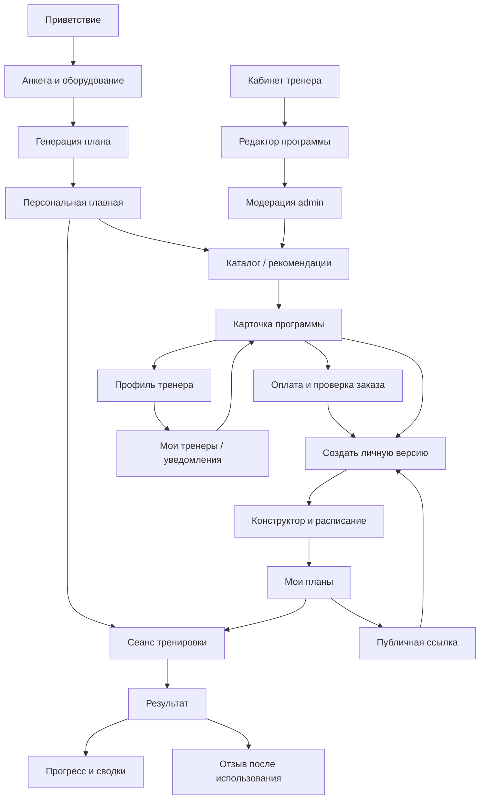

Стрелки Fork/оплаты/отзыва действуют только при серверном разрешении. При попытке private-действия посетитель сначала входит и возвращается на исходный экран. Новая копия не активируется автоматически без выбора расписания.

## 17. Figma

Тестовые макеты всех страниц: 74 экрана на 15 изображениях. Их можно использовать как основу и позже перенести в Figma. Это PNG-картинки; редактируемого Figma-файла пока нет, но он и не нужен. Просто в ИИ кидаешь фото страницы - он сам тебе сделает копию 1 в 1

На каждом изображении экраны пронумерованы слева направо, затем сверху вниз. Таблица под изображением связывает номер с маршрутом. Карточки деталей административных разделов `/:id` показаны боковыми панелями рядом со списком; при отдельном открытии сохраняют ту же компоновку.

### 17.1. Начало и анкета

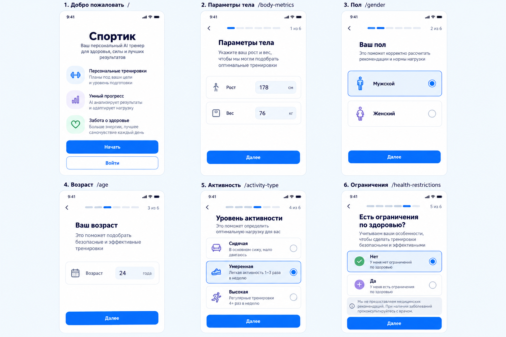

| № | Экран | Route |
|---|---|---|
| 1 | Добро пожаловать | `/` |
| 2 | Параметры тела | `/body-metrics` |
| 3 | Пол | `/gender` |
| 4 | Возраст | `/age` |
| 5 | Активность | `/activity-type` |
| 6 | Ограничения | `/health-restrictions` |

### 17.2. Цель, генерация и вход

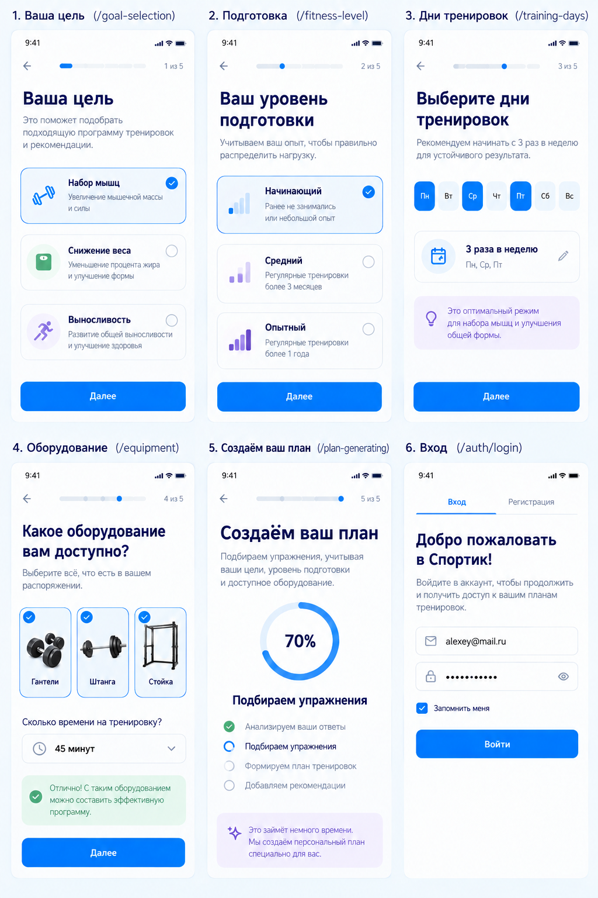

| № | Экран | Route |
|---|---|---|
| 1 | Ваша цель | `/goal-selection` |
| 2 | Подготовка | `/fitness-level` |
| 3 | Дни тренировок | `/training-days` |
| 4 | Оборудование | `/equipment` |
| 5 | Создаём ваш план | `/plan-generating` |
| 6 | Вход | `/auth/login` |

### 17.3. Главная и профиль

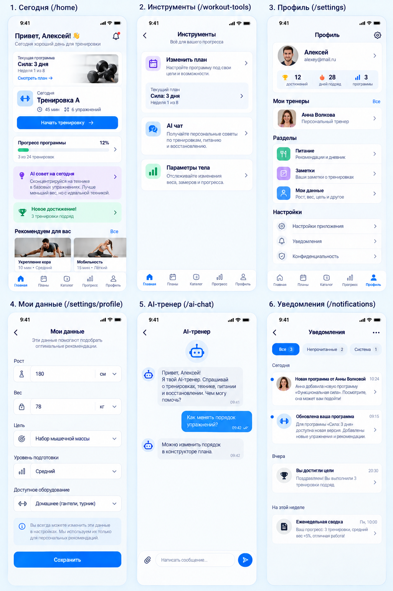

| № | Экран | Route |
|---|---|---|
| 1 | Сегодня | `/home` |
| 2 | Инструменты | `/workout-tools` |
| 3 | Профиль | `/settings` |
| 4 | Мои данные | `/settings/profile` |
| 5 | AI-тренер | `/ai-chat` |
| 6 | Уведомления | `/notifications` |

### 17.4. Заметки и дневник питания

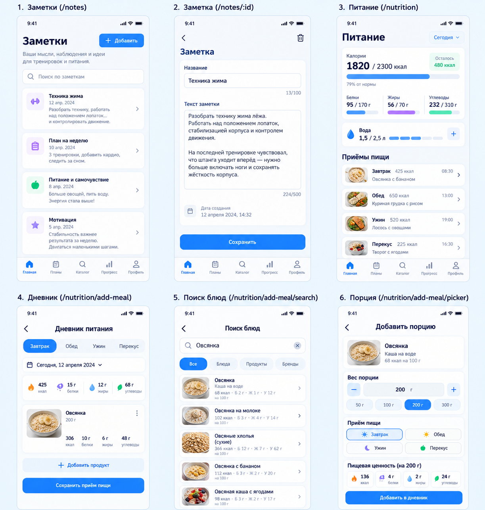

| № | Экран | Route |
|---|---|---|
| 1 | Заметки | `/notes` |
| 2 | Заметка | `/notes/:id` |
| 3 | Питание | `/nutrition` |
| 4 | Дневник | `/nutrition/add-meal` |
| 5 | Поиск блюд | `/nutrition/add-meal/search` |
| 6 | Порция | `/nutrition/add-meal/picker` |

### 17.5. Настройки питания

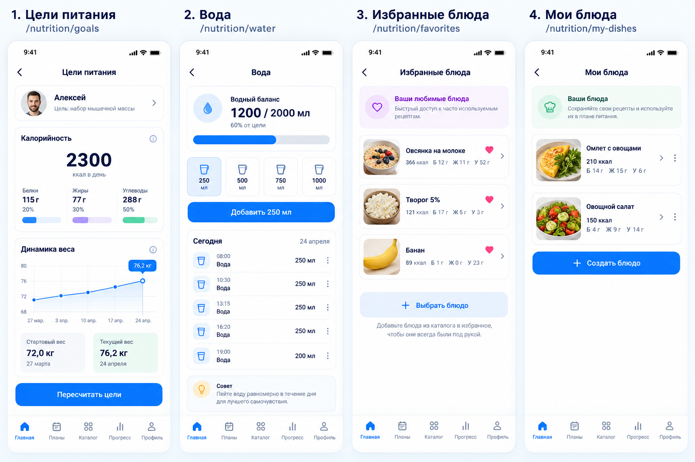

| № | Экран | Route |
|---|---|---|
| 1 | Цели питания | `/nutrition/goals` |
| 2 | Вода | `/nutrition/water` |
| 3 | Избранные блюда | `/nutrition/favorites` |
| 4 | Мои блюда | `/nutrition/my-dishes` |

### 17.6. Каталог и рекомендации

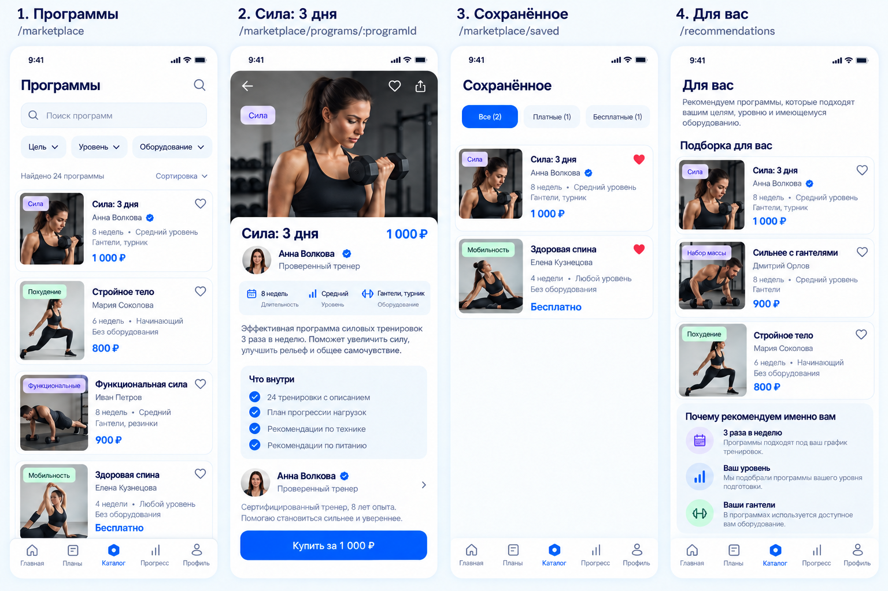

| № | Экран | Route |
|---|---|---|
| 1 | Программы | `/marketplace` |
| 2 | Сила: 3 дня | `/marketplace/programs/:programId` |
| 3 | Сохранённое | `/marketplace/saved` |
| 4 | Для вас | `/recommendations` |

### 17.7. Покупки и отзывы

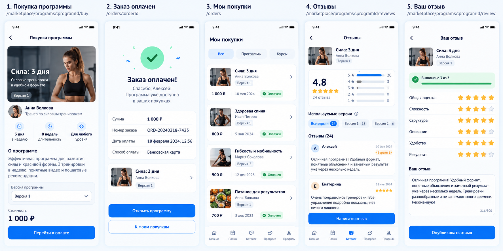

| № | Экран | Route |
|---|---|---|
| 1 | Покупка программы | `/marketplace/programs/:programId/buy` |
| 2 | Заказ оплачен | `/orders/:orderId` |
| 3 | Мои покупки | `/orders` |
| 4 | Отзывы | `/marketplace/programs/:programId/reviews` |
| 5 | Ваш отзыв | `/marketplace/programs/:programId/review` |

### 17.8. Личные планы и конструктор

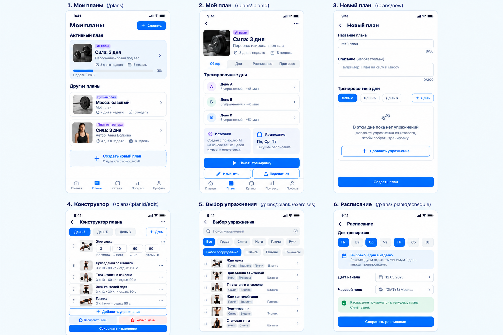

| № | Экран | Route |
|---|---|---|
| 1 | Мои планы | `/plans` |
| 2 | Мой план | `/plans/:planId` |
| 3 | Новый план | `/plans/new` |
| 4 | Конструктор | `/plans/:planId/edit` |
| 5 | Выбор упражнения | `/plans/:planId/exercises` |
| 6 | Расписание | `/plans/:planId/schedule` |

### 17.9. Тренировка и публичная программа

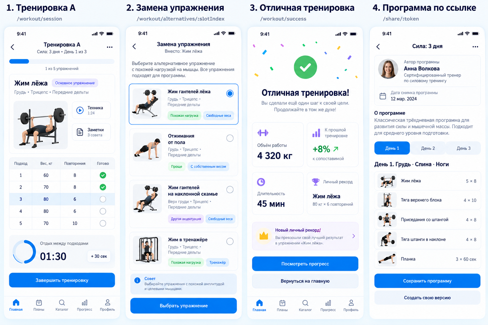

| № | Экран | Route |
|---|---|---|
| 1 | Тренировка А | `/workout/session` |
| 2 | Замена упражнения | `/workout/alternatives/:slotIndex` |
| 3 | Отличная тренировка | `/workout/success` |
| 4 | Программа по ссылке | `/share/:token` |

### 17.10. Прогресс и история

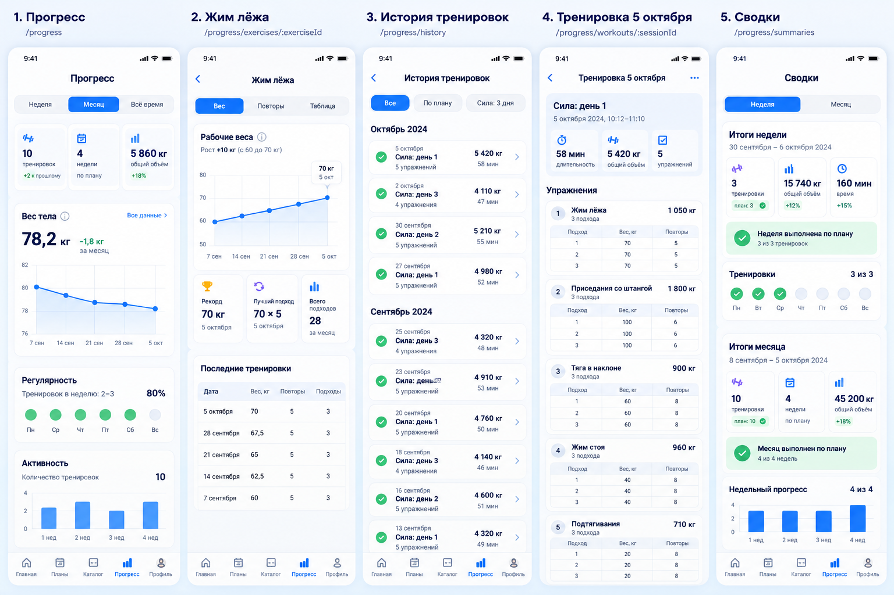

| № | Экран | Route |
|---|---|---|
| 1 | Прогресс | `/progress` |
| 2 | Жим лёжа | `/progress/exercises/:exerciseId` |
| 3 | История тренировок | `/progress/history` |
| 4 | Тренировка 5 октября | `/progress/workouts/:sessionId` |
| 5 | Сводки | `/progress/summaries` |

### 17.11. Тренеры и кабинет автора

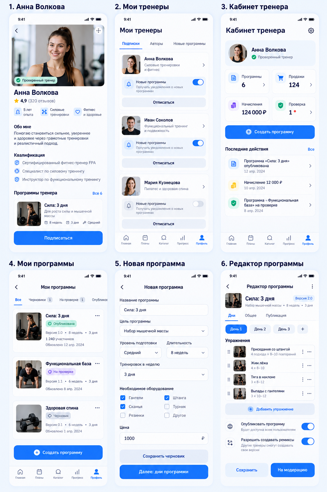

| № | Экран | Route |
|---|---|---|
| 1 | Анна Волкова | `/trainers/:trainerId` |
| 2 | Мои тренеры | `/settings/trainers` |
| 3 | Кабинет тренера | `/trainer` |
| 4 | Мои программы | `/trainer/programs` |
| 5 | Новая программа | `/trainer/programs/new` |
| 6 | Редактор программы | `/trainer/programs/:programId/edit` |

### 17.12. Профиль, проверка и финансы тренера

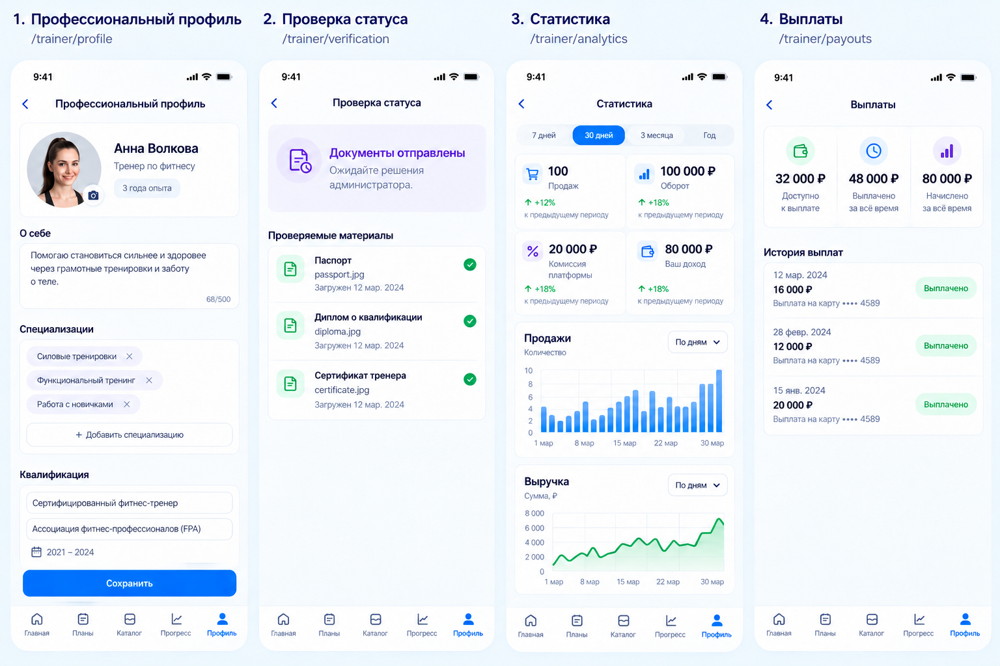

| № | Экран | Route |
|---|---|---|
| 1 | Профессиональный профиль | `/trainer/profile` |
| 2 | Проверка статуса | `/trainer/verification` |
| 3 | Статистика | `/trainer/analytics` |
| 4 | Выплаты | `/trainer/payouts` |

### 17.13. Администратор: обзор и люди

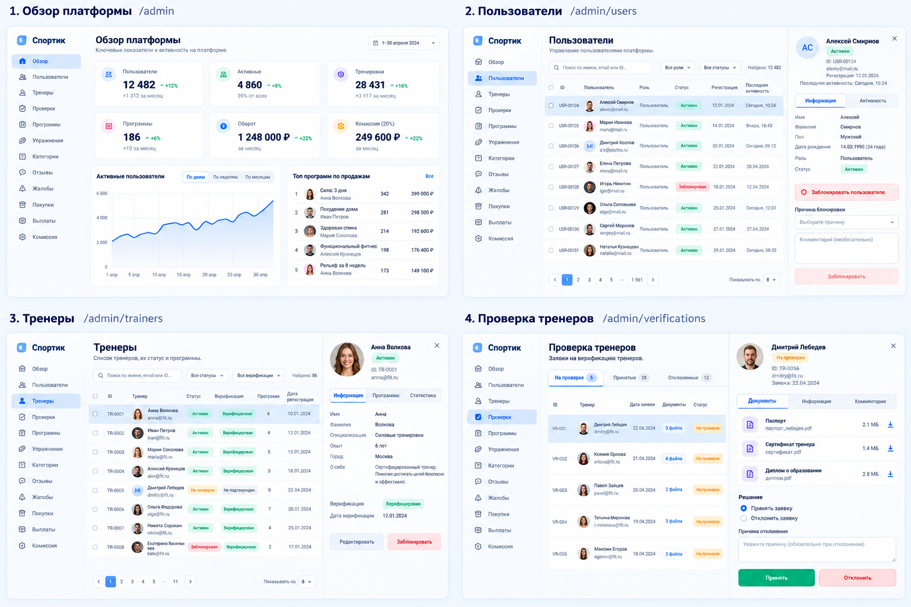

| № | Экран | Route |
|---|---|---|
| 1 | Обзор платформы | `/admin` |
| 2 | Пользователи | `/admin/users` |
| 3 | Тренеры | `/admin/trainers` |
| 4 | Проверка тренеров | `/admin/verifications` |

### 17.14. Администратор: контент

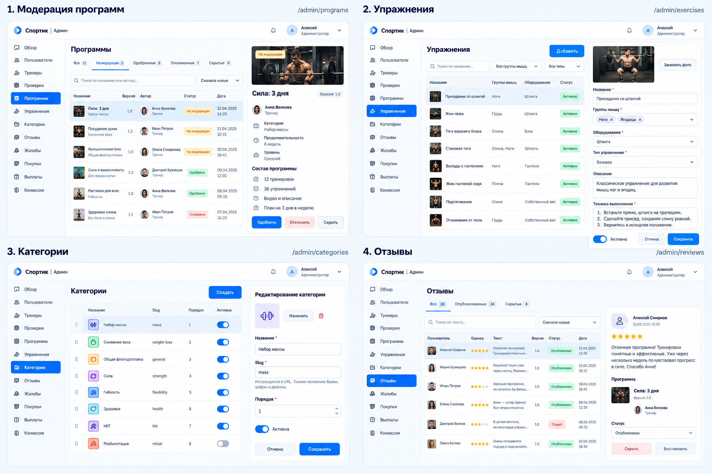

| № | Экран | Route |
|---|---|---|
| 1 | Модерация программ | `/admin/programs` |
| 2 | Упражнения | `/admin/exercises` |
| 3 | Категории | `/admin/categories` |
| 4 | Отзывы | `/admin/reviews` |

### 17.15. Администратор: жалобы и финансы

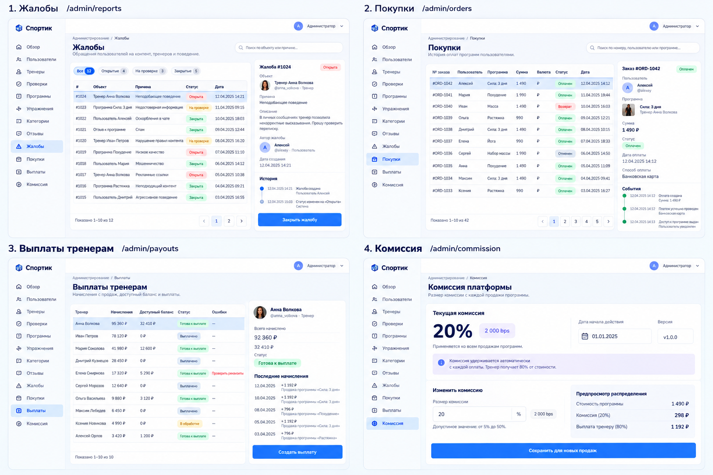

| № | Экран | Route |
|---|---|---|
| 1 | Жалобы | `/admin/reports` |
| 2 | Покупки | `/admin/orders` |
| 3 | Выплаты тренерам | `/admin/payouts` |
| 4 | Комиссия | `/admin/commission` |

## 18. Тестирование frontend

Тесты нужно писать вместе с реализацией экранов: проверять формы, действия пользователя, переходы и состояния loading, empty, error, success. API-ответы подменять тестовыми данными, чтобы проверять интерфейс независимо от готовности backend. Основные сценарии — создание плана, завершение тренировки, покупка и Fork — дополнительно проверять целиком в браузере.
