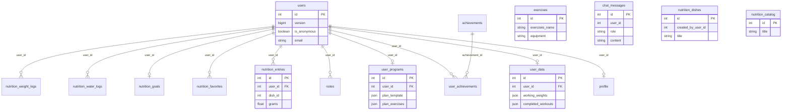
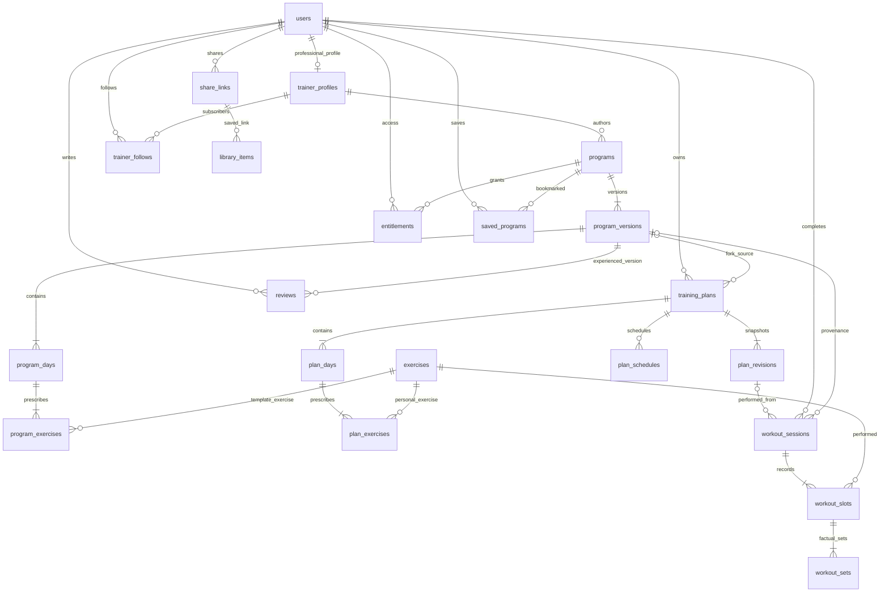
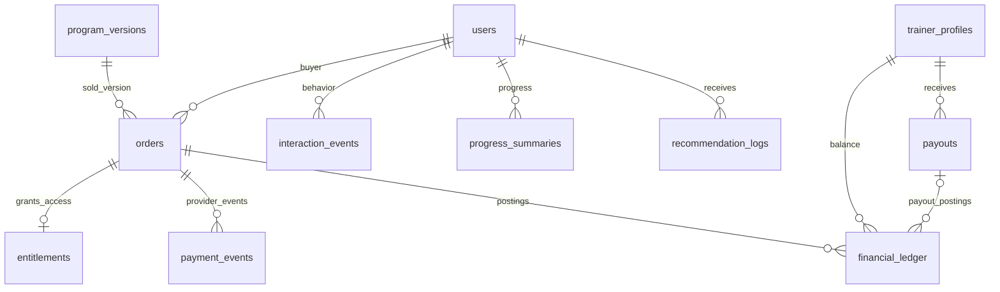

# 04. Структура данных

[Проект](01_PROJECT.md) · [API](02_API.md) · [Экраны](03_FRONTEND.md) · [ML](05_ML.md)

Дата: 05.10.2026. PostgreSQL, схема `sportapp`. Разделы 1–2 описывают миграции 000001–000006; остальное — предлагаемая модель для нового семестра.

## 1. Существующие таблицы

| Таблица | Ключи и основные поля | Назначение |
|---|---|---|
| users | id PK integer; version; is_anonymous; email; password_hash; timestamps; subscription_status | Аккаунт; уникальный lower(email) для непустых значений |
| profile | id PK; user_id FK UNIQUE; version; age,gender,height_cm,weight_kg,activity_level,injuries_notes boolean,goal,fitness_level,training_days_map text[] | Одна анкета на пользователя |
| user_data | id PK; user_id FK UNIQUE; version; working_weights/completed_workouts JSONB | Рабочие веса и история в JSON |
| exercises | id PK; exercises_name; muscular_group/subgroup; working_weights integer; safe_for_injuries; equipment; image_url; video_url | Справочник упражнений |
| user_programs | id PK; user_id FK UNIQUE; version; started_at; planned_end_at; is_active; plan_template/plan_exercises JSONB | Одна строка программы на пользователя, не библиотека |
| notes | id PK; user_id FK; title; body TEXT; version; timestamps; deleted_at | Личные заметки |
| chat_messages | id PK; user_id integer; role; content; send_at | История чата; FK user_id отсутствует в миграции |
| achievements | id PK; title; description; category | Справочник достижений |
| user_achievements | id PK; user_id FK; achievement_id FK; unlocked_at; UNIQUE(user_id,achievement_id) | Полученные достижения |
| nutrition_entries | id PK; user_id FK; dish_id integer; title; macros; calories; grams; meal_type; consumed_at | Дневник; dish_id без FK |
| nutrition_favorites | id PK; user_id FK; title; macros; unit_type | Избранные продукты |
| nutrition_goals | user_id PK/FK; macros; calories; timestamps | Цели питания |
| nutrition_catalog | id PK; title UNIQUE; macros; timestamps | Исходный каталог продуктов |
| nutrition_dishes | id PK; title UNIQUE; macros; calories; base_grams; created_by_user_id integer | Блюда; created_by_user_id без FK |
| nutrition_water_logs | id PK; user_id FK; logged_on; amount_ml; UNIQUE(user_id,logged_on) | Вода за день |
| nutrition_weight_logs | id PK; user_id FK; logged_on; weight_kg float; UNIQUE(user_id,logged_on) | История веса, переиспользуемая для прогресса |

В profile.weight_kg сейчас integer, в nutrition_weight_logs — дробное значение. injuries_notes boolean не описывает конкретные противопоказания. nutrition_catalog и nutrition_dishes — разные таблицы.

## 2. ER существующей схемы

Показаны физические FK. JSON-история не представляется как уже существующая нормализованная схема.

Связи chat_messages→users, nutrition_entries→nutrition_dishes, nutrition_dishes→users логически используются, но в прочитанных миграциях не закреплены FOREIGN KEY. Перед добавлением FK проверяются существующие строки.

## 3. Целевые сущности

Новые id — UUID, user_id/exercise_id сохраняют integer. Время TIMESTAMPTZ, деньги BIGINT в минимальных единицах, измерения NUMERIC. Имена таблиц — предложение, не выполненные миграции.

| Таблица | Поля и связи | Назначение |
|---|---|---|
| user_roles | user_id FK,role; составной PK | Совмещаемые роли user/trainer/admin |
| trainer_profiles | user_id PK/FK; display_name,photo_ref,bio,experience_years,qualifications,verified_at | Профессиональный профиль |
| trainer_specializations | trainer_id FK,specialization; составной PK | Специализации |
| trainer_verifications | id,trainer_id FK,status,document_refs,reviewer_id FK,reason,timestamps | Заявка и решение |
| equipment | id,code UNIQUE,name | Справочник оборудования |
| profile_equipment | user_id FK,equipment_id FK; составной PK | Доступное оборудование |
| exercise_equipment | exercise_id FK,equipment_id FK; составной PK | Требования упражнений |
| program_categories | id,slug UNIQUE,name,position,is_active | Категории |
| programs | id,trainer_id FK,published_version_id,status,created_at | Авторская программа и указатель публикации |
| program_versions | id,program_id FK,number,title,description,goal,level,duration_weeks,sessions_per_week,price_minor,currency,allow_public_remix,status | Неизменяемая публикация; UNIQUE(program_id,number) |
| program_version_categories | version_id FK,category_id FK; составной PK | Категории версии |
| program_version_equipment | version_id FK,equipment_id FK; составной PK | Оборудование версии |
| program_days | id,program_version_id FK,title,position | Дни шаблона |
| program_exercises | id,program_day_id FK,exercise_id FK,position,sets,reps_min/max,weight_kg,rest_sec | Авторские назначения |
| training_plans | id,owner_id FK,title,version,source_type,source_program_version_id FK nullable,is_active,archived_at | Личные AI/manual/Fork планы |
| plan_days | id,plan_id FK,title,position | Личные дни |
| plan_exercises | id,plan_day_id FK,exercise_id FK,position,sets,reps_min/max,weight_kg,rest_sec | Редактируемые задания |
| plan_schedules | id,plan_id FK,time_zone,start_date,weekday,plan_day_id FK,version | Версионированное расписание |
| plan_revisions | id,plan_id FK,number,snapshot JSONB,created_at | Снимки личного плана; UNIQUE(plan_id,number) |
| workout_sessions | id,user_id FK,plan_revision_id FK nullable,source_program_version_id FK nullable,client_session_id,started_at,finished_at,status | Факт занятия; UNIQUE(user_id,client_session_id) |
| workout_slots | id,session_id FK,exercise_id FK,position,exercise_snapshot JSONB | Фактическое упражнение и историческое название/единицы |
| workout_sets | id,slot_id FK,position,reps,weight_kg,is_warmup | Фактически выполненные подходы |
| saved_programs | user_id FK,program_id FK; составной PK | Избранное |
| library_items | id,user_id FK,program_id/share_id/plan_id FK nullable | Библиотека; ровно один target |
| entitlements | id,user_id FK,program_id FK,order_id FK nullable,status,granted_at | Бесплатный/платный доступ; UNIQUE(user_id,program_id) |
| share_links | id,owner_id FK,token_hash UNIQUE,target_type,snapshot JSONB,source_program_version_id FK nullable,expires_at,revoked_at,visibility | Отзываемая ссылка на программу/день |
| reviews | id,user_id FK,program_id FK,program_version_id FK,overall,optional_scores JSONB,text,moderation_status | Отзыв; UNIQUE(user_id,program_id) |
| trainer_follows | user_id FK,trainer_id FK,created_at; составной PK | Подписки |
| notifications | id,user_id FK,event_key,type,payload JSONB,read_at | Уведомления; UNIQUE(user_id,event_key) |

plan_day в расписании принадлежит своему plan_id. position уникален в пределах дня/версии. Пользовательская копия ссылается на точную source-версию. Использованные упражнения архивируются, а не удаляются.

## 4. ER целевых программ

programs.published_version_id должен принадлежать этой программе: составное ограничение или проверка транзакции. Черновик может быть неполным; обязательное наличие дней и упражнений проверяется перед публикацией.

## 5. Финансы, аналитика и служебные таблицы

| Таблица | Поля | Назначение |
|---|---|---|
| orders | id,buyer_id FK,program_id FK,program_version_id FK,amount_minor,currency,commission_bps,commission_minor,author_minor,status | Снимок цены и расчёта |
| payment_events | id,provider,provider_event_id UNIQUE,provider_payment_id,order_id FK,event_type,status,received_at | События провайдера и дедупликация |
| financial_ledger | id,order_id FK nullable,trainer_id FK,payout_id FK nullable,entry_type,amount_minor signed,currency,reversal_of_id FK nullable | Неизменяемый журнал начислений/возвратов/выплат |
| payouts | id,trainer_id FK,amount_minor,currency,status,provider_payout_id UNIQUE nullable,timestamps | requested→processing→paid/failed/cancelled |
| platform_settings | key PK,value JSONB,version,effective_at,updated_by FK | Комиссия и пороги |
| moderation_cases | id,target_type,target_id,status,moderator_id FK,reason | Проверка программ/отзывов |
| reports | id,reporter_id FK,target_type,target_id,reason,status,resolved_by FK | Жалобы |
| audit_events | id,actor_id FK,action,target_type,target_id,before/after JSONB,request_id,occurred_at | Аудит без паролей/секретов |
| idempotency_keys | user_id FK,operation,key,request_hash,response JSONB,expires_at; составной PK | Повтор операций |
| outbox_events | id,aggregate_id,type,payload JSONB,created_at,processed_at | Доставка событий после транзакции |
| interaction_events | id,user_id FK,event_id,program_id FK nullable,type,occurred_at,context JSONB | Поведение; UNIQUE(user_id,event_id) |
| recommendation_logs | id,user_id FK,request_id,model_version,candidate_ids/reason_codes JSONB,fallback,generated_at | Воспроизводимость рекомендаций |
| ml_model_versions | id,task,artifact_ref,dataset_version,feature_schema_version,metrics JSONB,status | Реестр моделей |
| progress_summaries | id,user_id FK,period_type,period_start,time_zone,metrics JSONB,computed_at,formula_version | Недельные/месячные сводки |

Показатели тренера/рейтинги вычисляются. Право отзыва выводится из доступа и workout_sessions с provenance; изменяемое пользователем eligible=true не хранится.

Polymorphic target_type/target_id не даёт обычного FK на несколько таблиц: backend проверяет тип и существование либо используются отдельные FK с CHECK «ровно одна ссылка». Это нужно реализовать явно.

## 6. Ограничения и индексы

- CHECK: цена/сумма ≥ 0, комиссия bps 0–10000, вес ≥ 0, повторения/подходы > 0, отдых ≥ 0, рейтинги 1–5. Диапазоны возраста, роста и нагрузки согласуются отдельно.
- Индексы sessions(user_id,finished_at DESC), slots(exercise_id,session_id), events(user_id,occurred_at DESC), orders(buyer_id,created_at DESC), orders(status,created_at), notifications(user_id,read_at,created_at).
- Каталог: status,goal,level,duration_weeks,trainer_id; связки equipment индексируются в обоих направлениях. Полнотекстовый поиск после измерения нагрузки.
- Частичный UNIQUE training_plans(owner_id) WHERE is_active AND archived_at IS NULL — один активный план.
- Повтор external payment/payout id запрещён. Обратная проводка не редактирует исходную.
- Фильтрация по owner обязательна на backend. PostgreSQL RLS — возможное дополнение, пока не реализовано.

## 7. Расчёты прогресса

| Показатель | Формула / определение | Особый случай |
|---|---|---|
| Количество тренировок | Уникальные completed sessions в периоде | Черновики/повторы исключены |
| Объём | Σ weight_kg × reps рабочих подходов | Разминка исключена; для собственного веса отдельно повторения |
| Рабочие веса | Максимальный рабочий вес упражнения за занятие, вместе с повторениями | Только одинаковые exercise_id/единицы |
| Рекорд | Новый исторический максимум рабочего веса/объёма упражнения | Первый результат — базовая точка |
| Прогресс упражнения | Ряды веса, повторений, объёма | Замена упражнения — другой ряд |
| Выполнение плана | Завершённые запланированные / запланированные до текущей даты | Знаменатель 0 → null; внеплановые отдельно |
| Регулярность | Последовательные закрытые недели с выполненным расписанием | Текущая неделя отдельно; учитывать снимок расписания |
| Вес тела | Последнее измерение минус первое в периоде | Меньше 2 измерений → недостаточно данных |
| Изменение объёма, % | 100 × (current − previous) / previous | previous=0 → delta_percent=null |

Неделя — понедельник–воскресенье, месяц — календарный, всё время — с первого результата. Интервал `[start,end)` по timezone пользователя переводится в UTC. Текущее питание использует Europe/Moscow — переход требует совместимости старых дат.

Пример: 3 × 60 кг × 10 = 1800 кг; затем 3 × 60 × 11 = 1980 кг, +10%. Числа вычисляет backend; AI может только переформулировать подтверждённое сообщение.
