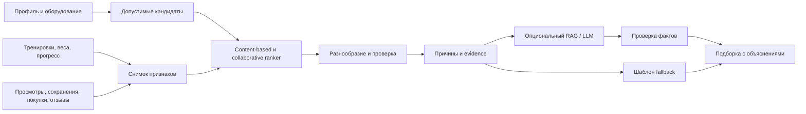

# 05. ML и интеллектуальная персонализация

[Проект](01_PROJECT.md) · [API](02_API.md) · [Экраны](03_FRONTEND.md) · [Данные](04_DATABASE.md)

Дата: 05.10.2026. Существующее отделено от проектируемого. 

## 1. Задачи

1. **F04: повысить качество существующего генератора.** Пересмотреть архитектуру, датасет и признаки, проверить CatBoost, сравнить альтернативы, улучшить сборку плана и провести полноценное тестирование.
2. **F03: рекомендовать программы маркетплейса.** Ранжировать совместимые программы по профилю, истории и поведению, объяснять каждую рекомендацию.
3. **AI-ассистент:** доработка

## 2. Существующие модули

| Модуль | Реализация | Вход → выход |
|---|---|---|
| `ai/main.py:predict` | CatBoostClassifier, `ai/models/model/workout_model.cbm` | 8 признаков → тип сплита |
| `ai/plan_service.py` | v2: CatBoost + шаблоны + независимая валидация | Профиль + каталог Go → дни и назначения; явный fallback на правила |
| `get_random_program` | random.choice по сплиту и числу дней | Тип + частота → шаблон групп мышц |
| Go ML-клиент | `backend/internal/features/mlclient/mlclient.go` | POST `/plan/user`, замена отдельных подгрупп |
| Go сборка | `users/service/generate_plan.go` + repository | Профиль → ML → упражнения БД → веса → сохранение |
| AI-чат | `ai/chat/chat_ml_service.py` | messages,user,plan → текст/поток; Cerebras/g4f при доступности, шаблонный fallback |
| Данные | `ai/generateData/human.py`, `plan.py` | Синтетические анкеты и правила → JSONL |

Классы: Фулбади, ВерхНиз, Тяни-толкай, Пуш-пул-ноги, Сплит. Порядок X: возраст,рост,вес,пол_num,тип_активности,травмы_num,цель,уровень_num. Частота не входит в X: дни используются только для фильтрации шаблона. Оборудование, история и прогресс текущей моделью не учитываются.


<a id="plan-generator"></a>
## 3. Целевой генератор

Валидация → feature snapshot → распределение типов сплита → допустимые структуры по частоте/оборудованию → выбор упражнений → подходы/повторения/отдых и стартовые нагрузки → проверка ограничений → сохранение plan_revision.

| Кандидат | Назначение сравнения |
|---|---|
| Текущий CatBoost + случайный шаблон | Зафиксированная baseline v0 |
| Экспертные правила | Прозрачная baseline без обучения |
| Новый CatBoost | Кандидат с переработанными признаками |
| Logistic Regression | Простая baseline с one-hot/scaling |
| Random Forest | Нелинейная baseline на том же split |
| Другой gradient boosting | Дополнительный эксперимент при наличии ресурса |

<a id="recommendations"></a>
## 4. Рекомендатель маркетплейса



**Вход:** профиль, цель, уровень, оборудование, частота, выполненные тренировки, рабочие веса, прогресс, просмотры/показы, сохранения, покупки, оценки, отзывы, поведение. Каталожные данные: опубликованная версия, структура, длительность, цена, уровень, оборудование и автор.

**Выход:** упорядоченный список program_id/version_id со score, reason_codes, evidence и объяснением. Score не является вероятностью спортивного результата.

1. Фильтр: только опубликованные, не заблокированные, совместимые с оборудованием и ограничениями программы. Работает и при fallback.
2. Content-based сопоставляет цель, уровень, частоту, длительность и оборудование. Главный источник холодного старта.
3. Collaborative использует сходство поведения при достаточных данных. В пустом маркетплейсе не имитируется обученная модель.
4. Ranker объединяет сигналы, свежесть и использование. Контролируются разнообразие авторов и покрытие новых программ.
5. Evidence формируется из проверяемых фактов: FREQUENCY_MATCH, LEVEL_MATCH, EQUIPMENT_MATCH.
6. RAG получает разрешённые описания конкретных версий и минимальный агрегированный контекст пользователя. LLM формулирует объяснение; не определяет доступ или rank свободным текстом.
7. Неподтверждённые утверждения, диагнозы и гарантии результата отклоняются; вместо них шаблон из evidence.

Пример: «Программа рассчитана на 3 тренировки в неделю, соответствует вашему уровню и использует доступное оборудование». Каждое утверждение проверяется по профилю и опубликованной версии. Текст отзывов — данные, а не инструкции LLM.

## 5. Фактический backend ↔ ML

Внутри Compose: `http://ml:8000/plan/user`. Frontend обращается к Go.

```json
{"age":26,"height_cm":175,"weight_kg":75,"gender":"м","activity_level":"Средняя активность","injuries_notes":false,"goal":"Набрать мышцы","fitness_level":"новичок","training_days_map":["Пн","Ср","Пт"]}
```

Сокращённый пример ответа одного дня; реальный результат должен содержать требуемое число дней:

```json
{"тип_сплита":"Фулбади","еженедельный_план":[{"день":"A","тип_дня":"Фулбоди A","упражнения":[{"группа":"Грудь","подгруппа":"грудные середина"}]}]}
```

ML возвращает группы, не назначения подходов. Go подбирает упражнения/веса и отдаёт [frontend-формат](02_API.md). Действующий Go timeout генерации — **52 секунды**.

Чат POST `/ai/user/chat`: `{messages,user,plan}` → text/plain/поток. Prompt использует последние 10 сообщений, backend history — 50. Поле model от frontend само по себе не гарантирует выбор конкретной Python-модели; провайдер зависит от конфигурации.

<a id="ml-contracts"></a>
## 6. Внутренние контракты v2

Только backend во внутренней сети, служебная авторизация и request_id. Оба конца валидируют схему; версия признаков/модели логируется.

### POST `/v2/plans/generate`

Реализован в ветке `backend/platform-v2`. Публичный Go `POST /api/v2/plans/generate`
принимает `{profile_version}` с JWT и `Idempotency-Key`. Go читает профиль, историю и
активный каталог из PostgreSQL, передаёт их ML со служебным Bearer-токеном.
ID упражнений не привязаны к порядку seed: обязательный `exercises` содержит актуальные
`exercise_id`, `muscle_group`, `muscle_subgroup`, `equipment_ids`.

```json
{"request_id":"req-plan-01","feature_schema_version":"profile-v2","profile":{"age":26,"height_cm":175,"weight_kg":75.5,"level":"beginner","goal":"muscle_gain","training_days":[1,3,5],"equipment_ids":["barbell","bench"],"excluded_exercise_ids":[],"session_duration_min":60,"gender":"м","activity_level":"Средняя активность","injuries_notes":false},"history":{"completed_28d":8,"adherence_28d":0.75,"exercise_metrics":[]},"exercises":[{"exercise_id":46,"muscle_group":"Грудь","muscle_subgroup":"грудные середина","equipment_ids":["barbell","bench"]}]}
```

Каталог в примере сокращён; для полного плана передаются все активные упражнения.
history может быть null. Неизвестные level/goal и версия признаков отклоняются (422).
Поддерживаются `beginner/intermediate/advanced`; цели `muscle_gain`, `weight_loss`,
`fat_loss`, `recomposition` и соответствующие русские значения baseline.
Пример сокращённого ответа:

```json
{"request_id":"req-plan-01","model_version":"catboost-v0-planner-v2","feature_schema_version":"profile-v2","split":"full_body","days":[{"weekday":1,"title":"День A","exercises":[{"exercise_id":46,"position":0,"sets":2,"reps_min":8,"reps_max":12,"weight_kg":null,"rest_sec":90}]}],"warnings":["INITIAL_WEIGHT_REQUIRES_CONFIRMATION"],"fallback":false}
```

Выбор упражнений ограничен оборудованием и явными исключениями. История используется
для предпочтения знакомых упражнений; веса остаются `null` до подтверждения пользователем.
Длительность проверяется по оценке: 5 минут подготовки + подходы × (3 секунды × верхняя
граница повторений + отдых). Это оценка сборщика, а не измеренная длительность занятия.
После ML Go повторно проверяет структуру, дни, действующие ID, оборудование, исключения
и версию профиля в транзакции. Новый план сохраняется отдельно; прежний активный план
не переключается автоматически. Deadline Go v2 — 8 секунд.

Если отсутствуют/не поддерживаются пол, активность или boolean травм старой baseline,
нет совместимого шаблона либо inference завершился ошибкой, выполняется full-body
сборка по правилам: `model_version=rules-v1`, `fallback=true`, предупреждение
`RULES_FALLBACK`. Она требует доступных упражнений для ног, груди и спины и соблюдает
те же ограничения. При невозможности собрать план возвращается 422 `NO_FEASIBLE_PLAN`.
Без настроенного `ML_SERVICE_TOKEN` v2 возвращает 503; без правильного Bearer — 401.

Интеграция использует имеющиеся веса CatBoost без переобучения. Qwen, его веса,
датасет `dataset_2.jsonlines` и результаты оценки из отчёта V2-24 не поставлены;
заявления о качестве трансформера и p95 этого отчёта этой реализацией не подтверждаются.
Ranking и explanation ниже остаются проектируемыми.

Локальная проверка (Python 3.11+, Go из `backend/go.mod`):

```sh
python3 -m venv ai/.venv
ai/.venv/bin/python -m pip install -r ai/requirements-test.txt
PATH="$PWD/ai/.venv/bin:$PATH" make -C ai test
make -C backend verify
```

Для запуска скопировать `ai/.env.example` в `ai/.env`, задать одинаковый отдельный
`ML_SERVICE_TOKEN` в нём и `backend/.env`. Из `ai/`:
`uvicorn main:app --env-file .env --host 127.0.0.1 --port 8000`.
`/health`, `/plan/user` и ML-чат сохраняют прежние контракты.

### POST `/v2/recommendations/rank`

```json
{"request_id":"req-rank-01","feature_schema_version":"ranking-v1","context":{"level":"beginner","goal":"muscle_gain","sessions_per_week":3,"equipment_ids":["barbell","bench"],"progress":{},"behavior":{}},"candidates":[{"program_id":"11111111-1111-4111-8111-111111111111","version_id":"22222222-2222-4222-8222-222222222222","level":"beginner","goal":"muscle_gain","sessions_per_week":3,"equipment_ids":["barbell","bench"]}],"limit":10}
```

Ответ `{request_id,model_version,items:[{program_id,version_id,score,reason_codes,evidence}],fallback}`. Id только из candidates. Backend ещё раз проверяет публикацию/доступ.

### POST `/v2/recommendations/explain`

Вход `{request_id,locale,items:[{program_id,version_id,reason_codes,evidence,allowed_context}]}`. Ответ `{request_id,items:[{program_id,text,source_version_ids,explanation_mode}]}`. Контекст минимальный и разрешённый. Без LLM остаётся шаблонное объяснение.

## 7. Время ответа

| Контур | Предлагаемая цель p95 | Deadline |
|---|---|---|
| ML + сборка плана | ≤ 3 с; весь Go запрос ≤ 5 с | 8 с, старый план не теряется |
| Ranking | ≤ 500 мс | 1 с, content-based/cache |
| LLM/RAG explanation | ≤ 2 с | 3 с, шаблон |
| Рекомендации целиком | ≤ 3 с | Возврат rank без зависшего LLM |
| Прогресс из агрегата | ≤ 500 мс | Пересчёт в фоне |


## 8. Метрики

| Задача | Метрики | Условие оценки |
|---|---|---|
| Сплит | Macro-F1 основная, balanced accuracy, accuracy, confusion matrix, per-class F1 | Один независимый test, срезы уровня/частоты |
| План | Доля допустимых, нарушения ограничений, покрытие оборудования/частоты, экспертная оценка | Сравнение всей цепочки, не только classifier |
| Rank | NDCG@10, Recall@10, MAP@10, coverage/diversity/cold-start | Временной test, одинаковые candidates |
| Объяснения | Подтверждённость утверждений, соответствие evidence, экспертная полезность, fallback rate | Автосверка + ручная разметка |
| Сервис | p50/p95 latency, error/timeout rate, availability | Cold/warm и сбои зависимостей |
| После выпуска | Использование подборки, сохранения, completion/adherence, возвраты/жалобы | Достаточная выборка; CTR одного недостаточно |

Предлагаемый gate: Macro-F1 не ниже v0 и прирост ≥ 0.03 абсолютных пункта либо обоснованный выигрыш качества плана; 
